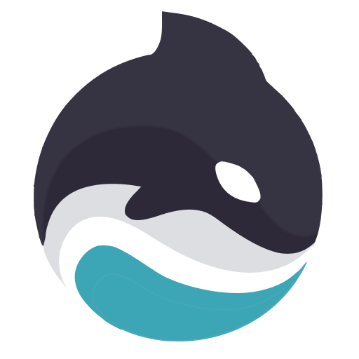
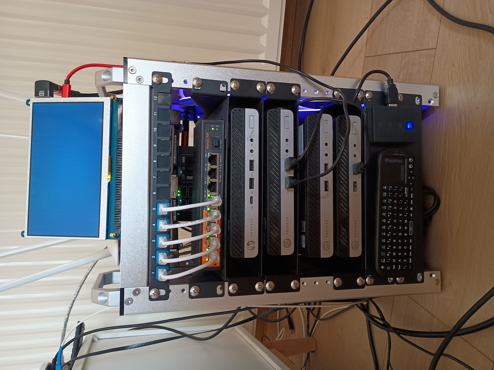

# Hi, I'm Denis

Platform engineer working at the intersection of production infrastructure and applied AI.

I build agent systems that reason over knowledge graphs, and the infrastructure that runs them.

**What I do**
- Platform engineering: AWS, Kubernetes, Terraform, internal developer platforms, CI/CD
- Applied AI: agent systems, GraphRAG, knowledge graphs, LLM observability

---

##  Korca

A support-ticket triage agent that answers one question support teams ask dozens of times a day: *who should handle this?*

Instead of matching keywords, Korca models a team's expertise as a Neo4j knowledge graph: who's resolved this kind of ticket, who knows this client, who owns the relevant SOP. It routes on that. In production it routes correctly **more than 90% of the time**.

- 📖 [How it works](https://medium.com/neo4j/switchboards-to-subgraphs-building-a-triage-agent-on-a-neo4j-knowledge-graph-842871a288bc) — published on the Neo4j blog
- 💻 [Source](https://github.com/alterminder/korca-aura-agent) — open source, MIT
- 🥉 3rd of 40+ projects, Neo4j Aura Agent Hackathon

**Stack:** Neo4j Aura · Aura Agent · FastAPI · Celery · Gemini embeddings · React

---

## 🏠 Homelab

A real Kubernetes cluster at home, where I run and break things before they reach production at work.

- **Kubernetes** with Cilium (eBPF networking), Longhorn storage
- **GitOps** end to end via ArgoCD
- **Infisical** for secrets, **LiteLLM** proxy + Langfuse for LLM routing and observability
- Self-hosted AI tooling, agent workloads, and whatever I'm currently testing

 

---

## Tech

- **Cloud & Platform:** `AWS (ECS, Fargate, Lambda, RDS, SQS)` `Kubernetes (EKS, Helm, Karpenter)` `Terraform/OpenTofu` `Docker`
- **GitOps & CI/CD:** `ArgoCD` `Argo Workflows` `GitHub Actions` `Infisical`
- **Observability:** `Prometheus` `Grafana` `Loki` `Langfuse (LLM tracing & cost)`
- **AI / LLM Systems:** `Neo4j & knowledge graphs` `GraphRAG & hybrid retrieval` `agents (PydanticAI, LangGraph)` `LiteLLM`
- **Languages & Data:** `Python (async, FastAPI)` `TypeScript/React` `Go` `PostgreSQL` `Redis` `Cypher`

---

## 📜 Certifications

<table>
  <tr>
    <td align="center" width="220"> <b>AWS Certified Solutions Architect</b></td>
    <td align="center" width="220"> <b>HashiCorp Certified: Terraform Associate</b></td>
    <td align="center" width="220"> <b>Neo4j Certified Professional</b></td>
  </tr>
</table>